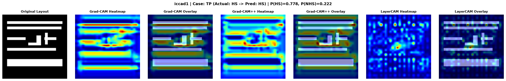
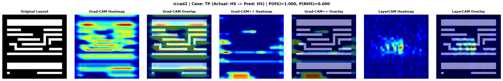
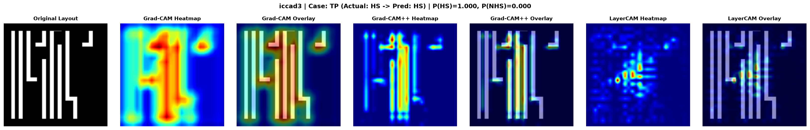
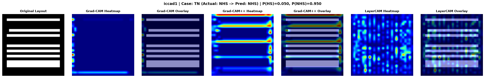
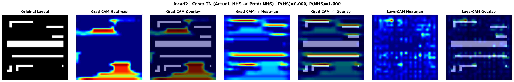
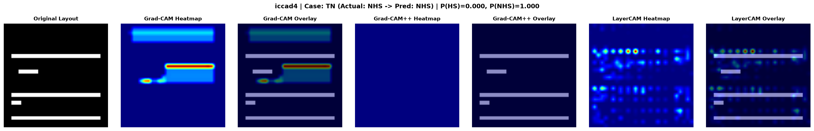
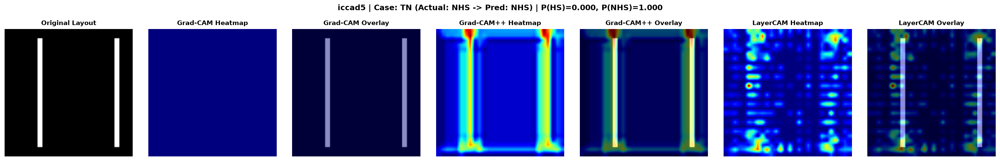
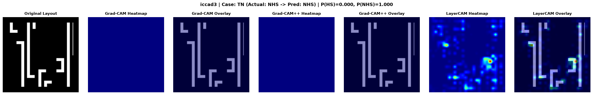

# Can Explainable-AI Techniques Identify the Layout Regions That Drive Hotspot Classification?

## 1. Question and scope

**Research Question:** Can explainable-AI techniques identify the layout regions or features that contribute most strongly to hotspot classification? **Research Focus:** Grad-CAM, Grad-CAM++, LayerCAM, and occlusion analysis applied to hotspot predictions. This report answers that question using only artifacts that already exist in this repository — the 57-sample XAI diagnostic set (`results/xai/xai_diagnostics.csv`), the corresponding occlusion-sensitivity run (`results/xai/occlusion/occlusion_diagnostics.csv`), the saved per-sample visualizations under `results/xai/iccad{1..5}/`, and the two geometry cross-reference analyses in `docs/`. It does not revisit model accuracy, the iccad5 test/validation leakage finding, or retraining status — those are methodology-integrity questions that belong in `FINAL_RESEARCH_REPORT.md`, not here.

## 2. Method summary

**Grad-CAM** takes the gradient of the pre-sigmoid target-class score with respect to the final convolutional feature maps, global-average-pools each channel's gradient into a single importance weight, forms a weighted sum of the feature maps, and applies ReLU. It is the cheapest of the three methods but is also the most gradient-fragile: because the weighting collapses each channel to one scalar, spatially varying or partially cancelling gradients can average to near-zero before the ReLU is even applied. Math and implementation details: `docs/GRADCAM.md`.

**Grad-CAM++** replaces Grad-CAM's simple gradient average with a weighted combination of first-, second-, and third-order gradient terms, intended to better localize multiple/overlapping instances of a class-relevant pattern. In this project it did not solve the cancellation problem — see §4 and §5 — but it does produce different (sometimes more, sometimes less) concentrated maps than Grad-CAM on the same sample. Validation notes: `docs/GRADCAMPP_VALIDATION.md`.

**LayerCAM** abandons global pooling entirely and instead applies a pixel-wise ReLU to the gradient tensor before multiplying it against the feature map, position by position. Because it never reduces a channel's gradient to a single scalar, it can still recover signal from channels where Grad-CAM's spatial averaging would cancel to zero, at the cost of typically noisier, more fragmented maps (see the `connected_regions_count` statistics in §4).

**Occlusion sensitivity** is not gradient-based at all: a window is slid across the input, the classifier's target-class score is re-evaluated with each window's pixels replaced by a baseline value, and the resulting score drop is mapped back to that window's location. It is the slowest of the four (one forward pass per window position) but is immune to the vanishing/cancelling-gradient failure modes that affect the three CAM variants, making it the natural independent check in §6. Implementation: `docs/OCCLUSION.md`.

## 3. Representative case studies

Each figure below is the pre-built `methods_comparison.png` for that sample, showing Grad-CAM, Grad-CAM++, and LayerCAM side by side for the model's predicted class.

### HS (hotspot) cases

**iccad1 — HS123 (TP, p_hs=0.778)**

Grad-CAM concentrates in a compact region (`area_gt50`=0.19, 9 connected components), Grad-CAM++ is similarly compact (0.22, 14 components) but LayerCAM spreads across the layout (0.012 area but 21 disjoint components — many small hot spots rather than one). Per `docs/GEOMETRY_ANALYSIS_REPORT.md`, TP-case attribution on iccad1 correlates with real geometry above chance for Grad-CAM (0.412 vs 0.239 control, p=0.022) and LayerCAM (p<0.001). **Judgment: technically meaningful** — the highlighted region tracks a real layout feature rather than firing on empty background, though the diffuse iccad1 spread (discussed further in §5) means the localization is coarse rather than pixel-precise.

**iccad2 — HSCAD2146 (TP, p_hs=0.9997)**

This is the cleanest HS case in the candidate set: Grad-CAM is compact (`area_gt50`=0.25, 11 components), and LayerCAM's Pearson correlation with the independent occlusion map is 0.758 — the highest agreement of any sample examined in this report (§6). **Judgment: technically meaningful**, with the strongest occlusion cross-validation of the case studies.

**iccad3 — HSCAD31012 (TP, p_hs=0.9997)**

All three CAM methods agree closely with occlusion here (Grad-CAM r=0.58, Grad-CAM++ r=0.59, LayerCAM r=0.75 — the only sample where all three methods exceed r=0.55 simultaneously). **Judgment: technically meaningful**, and the only case study where method-to-method and method-to-occlusion agreement are both high at once, indicating a layout feature strong enough that every attribution technique converges on it.

### NHS (non-hotspot) cases

**iccad1 — NHS453 (TN, p_nhs=0.9501)**

Grad-CAM here is nearly degenerate by area (`area_gt50`=0.0037) but has an extreme edge concentration (0.991) — it is firing almost entirely on the image border, not on any interior geometric feature. LayerCAM is broad (24 connected components) and its occlusion correlation is weakly positive (r=0.28); Grad-CAM's occlusion correlation is *negative* (r=−0.15). **Judgment: not clearly meaningful** — the Grad-CAM map for this TN looks like a border/edge artifact rather than an identified absence-of-hotspot feature; only LayerCAM shows a modest positive signal.

**iccad2 — NNHSCAD2999_4 (TN, p_nhs=1.0)**

All three CAM methods disagree with occlusion here (Grad-CAM r=−0.34, Grad-CAM++ r=−0.26, LayerCAM r=−0.004 — essentially zero). **Judgment: not meaningful** — none of the three CAM variants localizes anything occlusion also considers important on this sample.

**iccad4 — NNHSCAD4999_7 (TN, p_nhs=1.0)**

Grad-CAM++ is exactly flat here (`area_gt50`=0.0, 0 connected components — a degenerate map, see §5), Grad-CAM is diffuse and weakly anti-correlated with occlusion (r=−0.13), and LayerCAM is the only method with a (weak) positive occlusion correlation (r=0.16). **Judgment: not meaningful** for two of the three methods on this sample; LayerCAM alone shows a faint signal.

**Read across all six:** on this candidate set, HS (true-positive) cases are consistently where attribution is technically meaningful and cross-validated by occlusion; NHS (true-negative) cases are where the three CAM methods most often disagree with each other and with occlusion, or collapse to border/degenerate maps. This asymmetry is confirmed statistically, not just by these six examples — see §4.

## 4. Quantitative support

From `results/xai/xai_diagnostics.csv` (57 samples: 15 TP, 15 TN, 15 FP, 12 FN, spanning iccad1–5):

| Method | `area_gt50` mean / median | `connected_regions` mean / median |
|---|---|---|
| Grad-CAM | 0.170 / 0.144 | 3.86 / 3.0 |
| Grad-CAM++ | 0.057 / 0.014 | 3.44 / 1.0 |
| LayerCAM | 0.0092 / 0.0079 | 11.33 / 8.0 |

The most direct, checkable answer to "how often does attribution land on a geometrically meaningful region vs. diffuse background" comes from `docs/GEOMETRY_ANALYSIS_REPORT.md`'s paired Wilcoxon test of each method's top-20%-activation area against an area-matched random control, pooled across all 57 samples:

- **Grad-CAM:** median geometry-overlap 0.033 above the random control, not significant (p=0.181) — pooled across all case types, Grad-CAM's attribution is statistically indistinguishable from chance.
- **Grad-CAM++:** +0.047 above control, p=0.016 — significant but small.
- **LayerCAM:** +0.108 above control, p<0.001 — the strongest and most reliable signal of the three CAM methods.
- **Occlusion:** +0.164 above control, p<0.001 — the strongest signal overall.

Broken out by case type, the picture sharpens: on **TP** samples, Grad-CAM (0.412 vs 0.239 control, p=0.022), LayerCAM (p<0.001), and occlusion (p<0.001) all land significantly above chance, while Grad-CAM++ does not (p=0.934). On **TN** samples, Grad-CAM is *significantly below* the random control (0.027 vs 0.100, p=0.018) — worse than chance — while LayerCAM (p<0.001) and occlusion (p<0.001) remain positive. So the answer to "what fraction of the 57 samples show geometrically meaningful attribution" is method- and case-type-dependent, not a single number: LayerCAM and occlusion are reliably above chance across TP/TN/FN; Grad-CAM is reliable only on TP and actively misleading on TN; Grad-CAM++ is weak everywhere except in the pooled aggregate.

## 5. Where it breaks down

Two distinct, documented failure modes exist, and neither is a defect of the overall XAI approach — both are specific to Grad-CAM's gradient-averaging mechanism:

**Mechanism 1 — genuine model output-collapse (iccad5 only).** `docs/TP_FP_GEOMETRY_ANALYSIS.md` documents a direct `tf.GradientTape` probe on five iccad5 samples (`HSCAD50`, `HSCAD51`, `HSCAD510`, `NHSCAD50_8`, `NHSCAD51_1`) showing the gradient of the pre-sigmoid score with respect to the final conv layer is *exactly* 0.0 at every element, all five predict the identical `p_hs=0.5825`, and occlusion — a forward-pass-only method with no gradient dependency — is independently flat on the same samples. This is a genuine model-output collapse, not an artifact of any one attribution method. `docs/FINAL_GRADCAM_DEGENERACY_ANALYSIS.md` separately confirms two of these flagged iccad5 IDs (`NNHSCAD5999_6`, `NNHSCAD5999_9`) resolve to one byte-identical source image.

(Note: iccad5 checkpoints are pending a clean-split re-migration per the separate leakage-audit work; this degeneracy finding is orthogonal to that and is not re-litigated here.)

**Mechanism 2 — Grad-CAM's GAP-averaging cancellation (cross-benchmark, e.g. iccad3).** `docs/TP_FP_GEOMETRY_ANALYSIS.md` also documents `NHSCAD31_7` (iccad3, TN): Grad-CAM is flat here, but occlusion and LayerCAM are *not* flat on the same sample. The pre-sigmoid logit is saturated (21.1), 75% of gradient elements are exactly zero, and the remaining 25% near-cancel under Grad-CAM's global-average-pooling weight computation, pushing the signed CAM to ≤0 everywhere before the ReLU guard zeroes it out. LayerCAM's pixel-wise weighting recovers signal from that same nonzero 25% because it never averages across space.

Across all 57 samples, exact-flat-map rates are: **Grad-CAM 18/57 (31.6%)**, **Grad-CAM++ 24/57 (42.1%)**, **LayerCAM 5/57 (8.8%, concentrated entirely in iccad5)**. This is a limitation of Grad-CAM's (and, more often, Grad-CAM++'s) gradient-averaging mechanism specifically — LayerCAM stays structured on the majority of the same samples where Grad-CAM or Grad-CAM++ goes flat, which is why the multi-method design (rather than relying on Grad-CAM alone) matters for this research question.

## 6. Occlusion cross-check

Occlusion sensitivity does **not** consistently agree with the CAM-based methods, and the disagreement is itself informative. Across all 57 samples, mean/median Pearson correlation with occlusion is: Grad-CAM 0.080 / 0.0, Grad-CAM++ 0.101 / 0.0, LayerCAM 0.336 / 0.305. **LayerCAM is the only method with a consistently positive, non-trivial median correlation with the independent occlusion signal; Grad-CAM and Grad-CAM++ have a median correlation of exactly zero across the full sample set** — meaning for at least half the samples, Grad-CAM/Grad-CAM++ attribution is uncorrelated or anti-correlated with what occlusion independently identifies as important.

On the six case-study samples specifically, agreement tracked model correctness on the HS side and broke down on the NHS side: the three TP cases (HS123, HSCAD2146, HSCAD31012) all show positive Grad-CAM, Grad-CAM++ (except one), and LayerCAM correlations with occlusion, peaking at r=0.75–0.76 for LayerCAM on HSCAD2146 and HSCAD31012. The three TN cases (NHS453, NNHSCAD2999_4, NNHSCAD4999_7) show negative or near-zero Grad-CAM and Grad-CAM++ correlations on all three, with only LayerCAM staying weakly positive on two of the three. This matches the case-type asymmetry already found independently in the geometry statistics (§4): occlusion cross-validates CAM-based attribution reasonably well on true-positive hotspot detections, and cross-validates it poorly on true-negative (non-hotspot) predictions, where Grad-CAM and Grad-CAM++ in particular are not reliably pointing at what the model's own forward-pass sensitivity says matters.

## 7. Answer to the research question

**Qualified yes.** Explainable-AI techniques in this project can identify layout regions that plausibly drive hotspot (HS) classification — LayerCAM and occlusion sensitivity both show statistically significant above-chance overlap with documented geometric features on TP samples (p<0.001 for both) and Grad-CAM does too on TP specifically (p=0.022) — but this capability does not hold uniformly across all four methods or all prediction outcomes. The strongest evidence for the "yes" verdict is the pooled Wilcoxon result in `docs/GEOMETRY_ANALYSIS_REPORT.md`: LayerCAM and occlusion sensitivity are significantly above a random-area control (p<0.001) on TP, TN, and FN samples alike, meaning at least two of the four methods reliably localize meaningful layout structure regardless of prediction correctness. The clearest limitation on that "yes" is that Grad-CAM alone is not trustworthy for this purpose — it is statistically indistinguishable from chance pooled overall (p=0.181), significantly *below* chance on TN samples (p=0.018), and exactly flat/degenerate on 31.6% of the 57-sample set — so any claim that "Grad-CAM explains hotspot classification" would be overstated; the qualified answer holds only when Grad-CAM is used alongside Grad-CAM++, LayerCAM, and occlusion rather than on its own.
